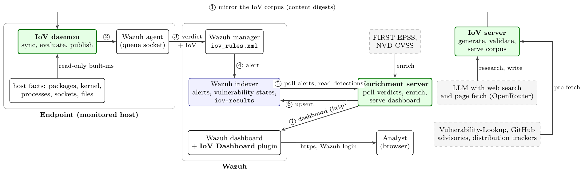

# Indicators of Vulnerability (IoVs)

Code and evaluation data for the paper *Beyond Version Matching: Generating Host-Specific Checks
for Actionable Vulnerability Intelligence in SIEMs*.

Wazuh's vulnerability detection matches package versions against CVE feeds and reports every match,
whether or not the vulnerable code can be reached on the host. **Indicators of Vulnerability (IoVs)**
are per-CVE documents that combine distribution-aware package version ranges with a sandboxed,
read-only precondition script written in a small statement layer over the Common Expression
Language (CEL). Example checks are "is this kernel module loaded?" and "is this service exposed to the
network?". An evaluator on each host turns an IoV into a confidence level (ABSENT, LOW, MEDIUM, HIGH
or INCONCLUSIVE) with a human-readable reason. IoVs are generated by an LLM with web research and
validated mechanically. The verdicts are integrated into Wazuh, where a dashboard combines them with
CVSS and EPSS to rank findings.

## Repository layout

| Path | Description |
|---|---|
| [`iov-evaluation/`](iov-evaluation) | The evaluator, which checks an IoV against the host it runs on: package version ranges, and the script interpreter with its read-only built-ins and sandbox limits. It builds the standalone `evaluate-iov` CLI and the `wazuh-evaluate-iov-daemon` for Wazuh agents. Contains the IoV JSON schema. |
| [`iov_server/`](iov_server) | Generates and serves IoVs, one per CVE. Generation pre-fetches advisory and distribution-tracker data, runs LLM research with web search, writes the IoV under a schema constraint, and validates it with the evaluator's own validator. Built with FastAPI and Celery. Contains the generated corpus of the evaluation ([`iov_data/`](iov_server/iov_data)), the IoV specification and generation prompt ([`prompt/prompt6.txt`](iov_server/prompt/prompt6.txt)) and an admin CLI. |
| [`wazuh-integration/`](wazuh-integration) | The Wazuh integration. Its enrichment server (ETSO) copies the verdicts from Wazuh's alerts into the `iov-results` index, adds EPSS and CVSS, and serves the prioritization dashboard. [`installation/`](wazuh-integration/installation) holds the endpoint installer, the manager rules and the Wazuh dashboard plugin. |
| [`docs/`](docs) | Material that supplements the paper: the architecture diagram, the full table of evaluated CVEs and a dashboard demo video. |

## Getting started

Each service has its own README, `requirements.txt` and example environment file. To run the whole
system:

1. **Wazuh.** You need a Wazuh manager, indexer and dashboard (we used Wazuh 4.8, the
   [wazuh-docker](https://github.com/wazuh/wazuh-docker) single-node deployment), with agents
   reporting vulnerability scans.
2. **IoV server.** Run `cd iov_server && cp .env.example .env && docker compose up -d --build`. It
   needs an OpenRouter API key for generation. See [`iov_server/README.md`](iov_server/README.md).
3. **Enrichment server.** Run `cd wazuh-integration && cp example.env .env && docker compose up -d --build`.
   It needs the Wazuh API and indexer credentials and the IoV server URL. See
   [`wazuh-integration/README.md`](wazuh-integration/README.md).
4. **Endpoints and manager.** Install `wazuh-evaluate-iov-daemon` on the agents
   ([`installation/endpoints/`](wazuh-integration/installation/endpoints)). On the manager, install
   the rules and, optionally, the dashboard plugin
   ([`installation/manager/`](wazuh-integration/installation/manager)). The install order and
   end-to-end checks are in [`wazuh-integration/DEPLOYMENT.md`](wazuh-integration/DEPLOYMENT.md).
5. **Use it.** Open **IoV Dashboard** in the Wazuh menu. To queue IoV generation for the CVEs
   detected on an agent, run `python3 wazuh-integration/src/cli.py queue-iovs <agent>`.

You can also try parts of the system without Wazuh:

- **Dashboard on demo data.** Run `cd wazuh-integration/src && python3 -m dashboard --demo`, then
  open <http://127.0.0.1:8050/dashboard/>.
- **A single IoV.** Evaluate it on any x86-64 Linux host with
  `iov-evaluation/dist/evaluate-iov iov_server/iov_data/<CVE>.iov.json`. Run it as root for
  complete host facts.

## Evaluation

The paper evaluates 66 CVEs on a deliberately outdated Ubuntu 24.04 host. The full table of results
is in [`docs/cve_table.pdf`](docs/cve_table.pdf), and the IoVs generated for these CVEs are in
[`iov_server/iov_data/`](iov_server/iov_data).
